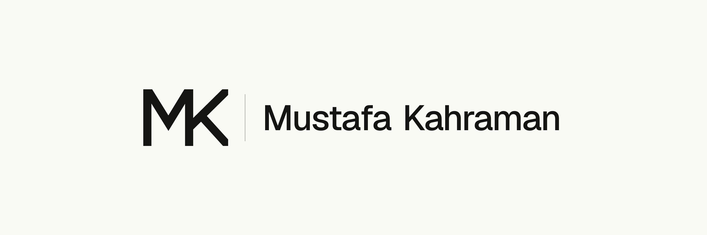
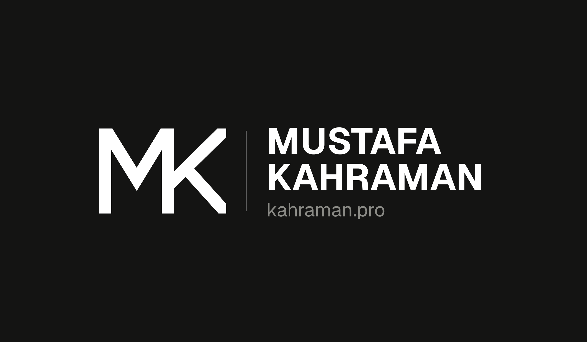
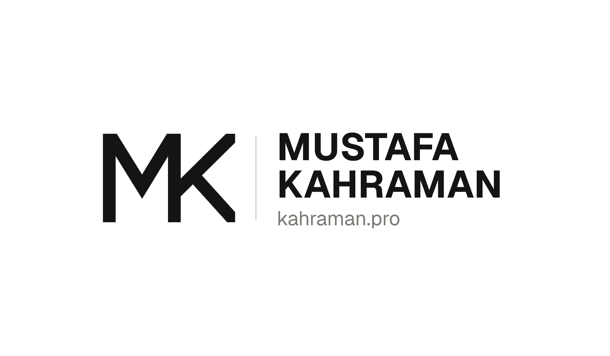
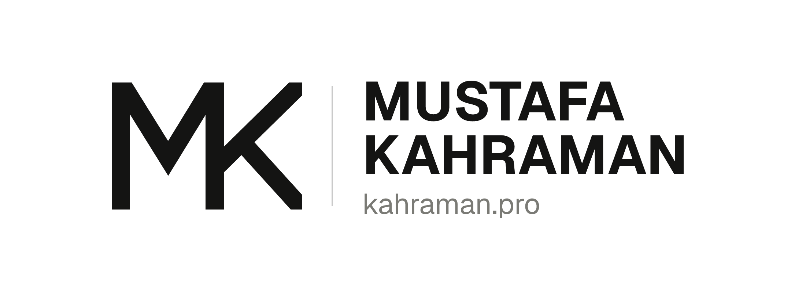
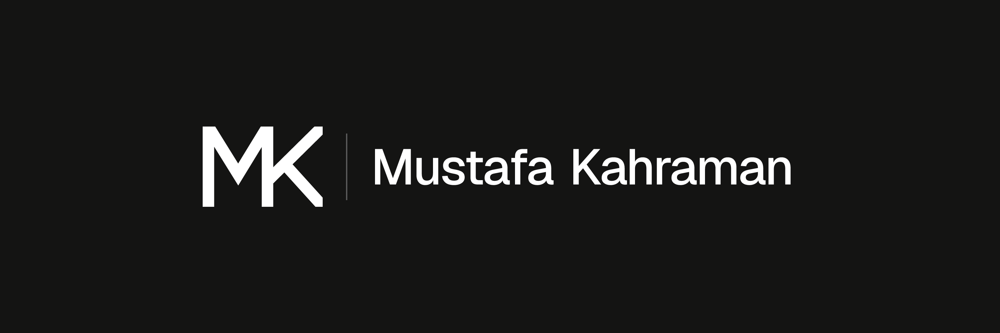

<div align="center">

<a href="https://kahraman.pro">
  
</a>

# kahraman.pro

**Software and AI, built for how your team works.**

The website of [Mustafa Kahraman](https://kahraman.pro), a software engineer and AI consultant in İzmir, Türkiye.
I find where software and AI save a team the most time, then design and build it myself, end to end.

[**Visit kahraman.pro →**](https://kahraman.pro) &nbsp;·&nbsp; [Services](https://kahraman.pro/services) &nbsp;·&nbsp; [My work](https://kahraman.pro/work) &nbsp;·&nbsp; [hello@kahraman.pro](mailto:hello@kahraman.pro)

[](https://kahraman.pro)
[](https://www.linkedin.com/in/mustafa--kahraman)
[](https://github.com/kahramanX)
[](https://www.upwork.com/freelancers/~014a9ab0f0d2aab6f3)


</div>

---

## Who I am

I have built software professionally since 2021. At an agency in Istanbul I worked on stores, backend services, integrations and platform migrations for **15 retail and corporate brands**, with about **3M monthly visits** in total, including New Balance, Vitra, Arçelik, İpekyol and Suwen. Today I also build and run my own products, including **[SetupBook](https://setupbook.io)**, a live AI product.

I work alone, so you talk to me directly and I do the work myself. No account managers, no handoffs. I pick the tools that fit your job, and I test everything before it reaches you.

**Have work that should take less time?** Write to [hello@kahraman.pro](mailto:hello@kahraman.pro) with your project, your tools and your goal. I reply within one working day.

## What I can build for you

| Service | What you get |
| --- | --- |
| [**Custom software**](https://kahraman.pro/services/custom-software) | Web apps, internal tools, backends, APIs and mobile apps, designed and built end to end. |
| [**AI agents and AI features**](https://kahraman.pro/services/ai-agents) | Agents, chatbots and MCP servers that answer from your own data, sort and tag records and write reports, with a person checking where a mistake would cost money. |
| [**AI consulting**](https://kahraman.pro/services/ai-consulting) | A clear view of where AI helps your team and where it does not, and a plan in the order to build it. |
| [**Integrations and automation**](https://kahraman.pro/services/integrations) | Your store, app, CRM, email, databases, marketplaces, analytics and payment tools kept in sync, with failures flagged instead of hidden. |
| [**Rescue and modernisation**](https://kahraman.pro/services/fixes) | Stopped workflows, agents with wrong answers, slow pages, prototypes with no logs and old code found, fixed and documented. |

## Selected work

| Project | |
| --- | --- |
| [**SetupBook**](https://kahraman.pro/work/setupbook) | A live trading journal with an AI coach built on the Gemini API, 16 broker integrations, payments and 9 languages. Designed and built solo. [setupbook.io](https://setupbook.io) |
| [**Software for retail brands**](https://kahraman.pro/work/retail-ecommerce) | Stores, backend services, 15+ integrations and a move of 8 sites to microservices. LCP from 3.8 s to 1.5 s, mobile Lighthouse from 52 to 86. |
| [**Market Hours**](https://kahraman.pro/work/market-hours) | A live world map of open stock exchanges and forex sessions, with holidays and alarms. [markethours.live](https://markethours.live) |
| [**Passport.AI**](https://kahraman.pro/work/passport-ai) | An ID and passport photo app with on-device face checks and AI retouching, for 250 countries. |
| [**PreChart**](https://kahraman.pro/work/prechart) | A chart-analysis app that draws support, resistance, zones and scenarios on top of your own chart screenshot, with the price axis calibrated on the phone. |
| [**Vocabulary**](https://kahraman.pro/work/english-vocabulary) | A swipe-card app for English words with audio, 17 games and spaced repetition in 24 languages. |

---

## About this repository

This is the source of [kahraman.pro](https://kahraman.pro). It is a small, fast, fully static site with no database, built to show the same care I put into client work.

### Stack

- **[Next.js 15](https://nextjs.org)** (App Router), every page prerendered at build time
- **TypeScript** in strict mode
- **[Tailwind CSS v4](https://tailwindcss.com)** for all styling, with no hand-written CSS rules
- **Geist** via `next/font`, `next/image` for responsive AVIF and WebP images
- **`next/og`** for the generated share image and Apple touch icon

### Highlights

- **SEO from top to bottom:** unique titles and descriptions, canonical URLs, Open Graph and Twitter cards, JSON-LD (`Person`, `ProfessionalService`, `WebSite`, `Service`, `CreativeWork`, `ItemList`, `BreadcrumbList`), an image sitemap, `robots.txt`, a web manifest and [`llms.txt`](https://kahraman.pro/llms.txt) for AI assistants.
- **Case studies** with a full-screen image viewer (keyboard and swipe), App Store and Google Play buttons and each app's legal documents.
- **App legal documents** (privacy, terms, account deletion, support) for every mobile app at `/<doc>/<repo>`, written once from shared, typed building blocks.
- **Mobile first and accessible:** a skip link, visible focus states, real buttons and links, `aria` labels, and support for reduced motion.
- **Content as data:** services, projects, store links and legal texts live in typed files under `src/content`, so updating the site means editing text, not components.

### Project structure

```text
src/
├── app/                 # Routes, metadata, sitemap, robots, manifest, share images
│   ├── services/        # /services and /services/[slug]
│   ├── work/            # /work and /work/[slug]
│   └── privacy|terms|delete-account|support/[app]   # App legal documents
├── components/          # Header, footer, lightbox, store buttons, markdown, legal page
├── content/             # Site config, services, projects, store links, app legal texts
└── lib/                 # Shared Tailwind class sets (ui.ts) and SEO helpers (seo.ts)
public/
├── brand/               # Logo files (PNG)
└── work/                # Project screenshots
```

### Run it locally

```bash
npm install
cp .env.example .env.local   # then set NEXT_PUBLIC_SITE_URL
npm run dev                  # http://localhost:3000
```

| Command | What it does |
| --- | --- |
| `npm run dev` | Start the development server on port 3000 |
| `npm run build` | Build the production site |
| `npm start` | Serve the production build on port 3000 |

### Environment variables

Read in one place, [`src/lib/env.ts`](src/lib/env.ts). See [`.env.example`](.env.example). `NEXT_PUBLIC_*` values are inlined at build time.

| Variable | Purpose |
| --- | --- |
| `NEXT_PUBLIC_SITE_URL` | **Required.** Public URL used for canonical links, Open Graph, JSON-LD and the sitemap |
| `NEXT_PUBLIC_BOOKING_URL` | Optional. A Calendly or Cal.com link; turns contact buttons into "Book a call" |
| `GOOGLE_SITE_VERIFICATION` | Optional. Google Search Console meta tag |
| `BING_SITE_VERIFICATION` | Optional. Bing Webmaster Tools meta tag |

### Brand

The **MK** monogram is drawn as one line: the right leg of the M is also the stem of the K. Logo files in light, dark and transparent versions are in [`public/brand`](public/brand).

<p>
  
  &nbsp;
  
  &nbsp;
  
  &nbsp;
  
  &nbsp;
  
  &nbsp;
  
  &nbsp;
  
</p>

<p>
  
  &nbsp;
  
  &nbsp;
  
  &nbsp;
  
  &nbsp;
  
  &nbsp;
  
</p>

<p>
  
  &nbsp;
  
  &nbsp;
  
  &nbsp;
  
</p>

---

<div align="center">

**Need software or AI work done properly?**

[kahraman.pro](https://kahraman.pro) · [hello@kahraman.pro](mailto:hello@kahraman.pro) · [LinkedIn](https://www.linkedin.com/in/mustafa--kahraman) · [GitHub](https://github.com/kahramanX) · [Upwork](https://www.upwork.com/freelancers/~014a9ab0f0d2aab6f3)

© Mustafa Kahraman. The code is shared for reference; the content, logo and project images are not licensed for reuse.

</div>
